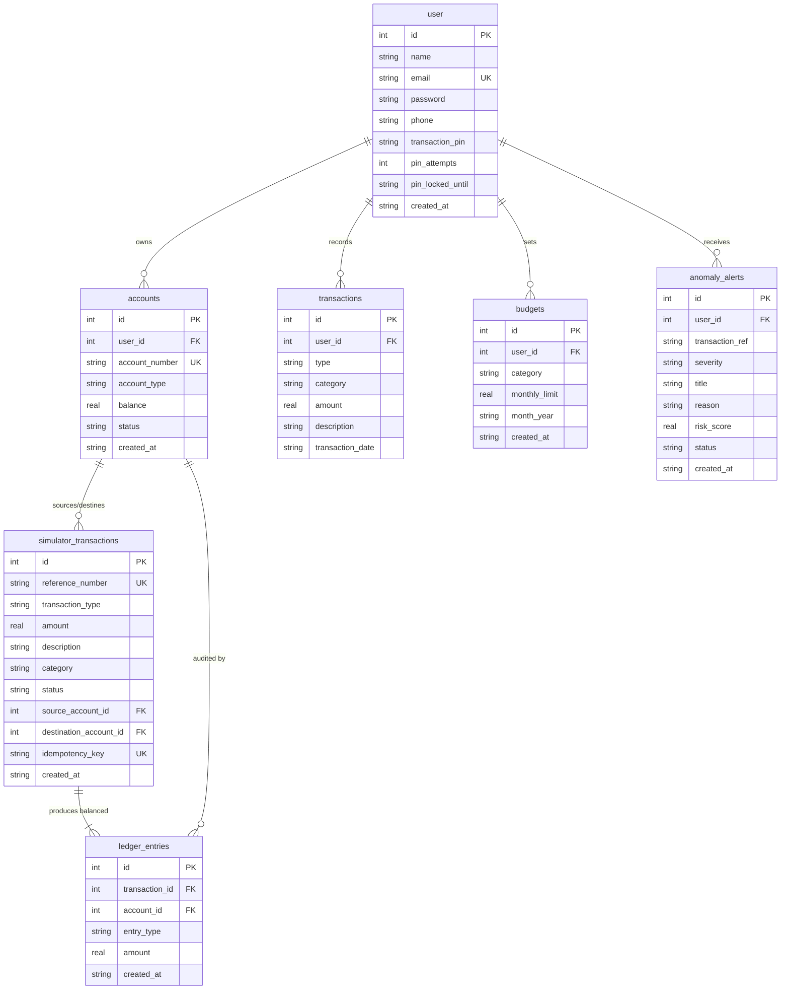

# FinSight — Database & Ledger Reference Manual

**Auditor:** Principal Fintech Database Architect & Systems Auditor  
**Engine:** SQLite 3.45.3 (JDBC 3.45.3.0)  
**Configuration:** Write-Ahead Logging (`PRAGMA journal_mode = WAL;`), `PRAGMA busy_timeout = 10000;`, `PRAGMA foreign_keys = ON;`  
**Production Database Path:** `data/finsight.db`  
**Verified SHA-256:** `235E255563F4AE5FC749AD5824156C49BF48A6C45C60E46DCB92E2605518294C`  

---

## 1. COMPLETE SCHEMA DEFINITIONS & CONSTRAINTS

Schema initialization is implemented programmatically in [`DBConnection.java:100-220`](file:///d:/DIVY/webDev/Projects/FinSight/src/main/java/com/expense/util/DBConnection.java#L100-L220).

### Entity Relationship Diagram


---

## 2. DOUBLE-ENTRY LEDGER ACCOUNTING RULES

FinSight enforces formal double-entry bookkeeping across all banking simulator operations:

### 2.1 Accounting Equation & Invariant
For every financial operation recorded in `simulator_transactions`:
$$\sum \text{Amount}_{\text{DEBIT}} = \sum \text{Amount}_{\text{CREDIT}} = \text{Transaction Amount}$$

### 2.2 Operational Posting Matrix

| Operation | Debit Entry (Target & Meaning) | Credit Entry (Target & Meaning) | Stored Balance Impact |
|---|---|---|---|
| **Deposit** | `FS-SYSTEM-CLEARING` (Account ID 999999)<br/>*Institutional cash assets increase.* | Customer Account (`accounts.id`)<br/>*Customer deposit liability increases.* | Customer Account Balance $+ \text{Amount}$ |
| **Withdrawal** | Customer Account (`accounts.id`)<br/>*Customer deposit liability decreases.* | `FS-SYSTEM-CLEARING` (Account ID 999999)<br/>*Institutional cash assets decrease.* | Customer Account Balance $- \text{Amount}$ |
| **Transfer** | Source Account (`source_account_id`)<br/>*Sender deposit liability decreases.* | Destination Account (`destination_account_id`)<br/>*Recipient deposit liability increases.* | Sender Balance $- \text{Amount}$<br/>Recipient Balance $+ \text{Amount}$ |

### 2.3 Mathematical Reconciliation
Customer account balances must reconcile mathematically with their historical ledger entries:
$$\text{Reconciled Balance} = \sum_{\substack{\text{account\_id} = A \\ \text{entry\_type} = \text{'CREDIT'}}} \text{Amount} - \sum_{\substack{\text{account\_id} = A \\ \text{entry\_type} = \text{'DEBIT'}}} \text{Amount}$$

Evaluated via `LedgerDAO.calculateReconciledBalance(int accountId)`.

---

## 3. MONETARY PRECISION & REVERSIBLE INTEGER-PAISE MIGRATION PLAN

### 3.1 Current Status & Analysis
- **Database Storage:** All monetary columns (`balance`, `amount`, `monthly_limit`) currently use SQLite `REAL`.
- **Java Runtime Representation:** Fully mapped to `java.math.BigDecimal` with `setScale(2, RoundingMode.HALF_UP)`.
- **Finding:** While Java-side calculations are exact, SQLite `REAL` uses 64-bit IEEE 754 floating-point values, which can introduce micro-rounding drift upon millions of SQL aggregations.
- **Production Status:** The production database was **explicitly NOT migrated**, ensuring zero risk to existing records.

### 3.2 Additive, Zero-Risk Migration Blueprint
When approved, the migration should follow an additive 4-phase rollout:

#### Phase 1 — Non-Destructive Column Expansion
```sql
ALTER TABLE accounts ADD COLUMN balance_paise INTEGER DEFAULT 0;
ALTER TABLE simulator_transactions ADD COLUMN amount_paise INTEGER DEFAULT 0;
ALTER TABLE ledger_entries ADD COLUMN amount_paise INTEGER DEFAULT 0;
ALTER TABLE transactions ADD COLUMN amount_paise INTEGER DEFAULT 0;
ALTER TABLE budgets ADD COLUMN monthly_limit_paise INTEGER DEFAULT 0;
```

#### Phase 2 — Exact Backfill Conversion
```sql
UPDATE accounts SET balance_paise = CAST(ROUND(balance * 100) AS INTEGER);
UPDATE simulator_transactions SET amount_paise = CAST(ROUND(amount * 100) AS INTEGER);
UPDATE ledger_entries SET amount_paise = CAST(ROUND(amount * 100) AS INTEGER);
UPDATE transactions SET amount_paise = CAST(ROUND(amount * 100) AS INTEGER);
UPDATE budgets SET monthly_limit_paise = CAST(ROUND(monthly_limit * 100) AS INTEGER);
```

#### Phase 3 — Consistency Check Invariant
```sql
SELECT COUNT(*) FROM accounts WHERE balance_paise != CAST(ROUND(balance * 100) AS INTEGER);
```
Must return `0` prior to cutting over DAOs to read from `paise` columns.

---

## 4. CONCURRENCY & ISOLATION CONFIGURATION

SQLite concurrency is configured in [`DBConnection.java:70-85`](file:///d:/DIVY/webDev/Projects/FinSight/src/main/java/com/expense/util/DBConnection.java#L70-L85) using native driver properties:
```java
org.sqlite.SQLiteConfig config = new org.sqlite.SQLiteConfig();
config.enforceForeignKeys(true);
config.setBusyTimeout(10000); // 10-second wait on lock acquisition
config.setJournalMode(org.sqlite.SQLiteConfig.JournalMode.WAL);
config.setSynchronous(org.sqlite.SQLiteConfig.SynchronousMode.NORMAL);
```

### Architectural Implications:
1. **Write-Ahead Logging (WAL):** Allows simultaneous readers to read from the database without being blocked by an active writing transaction.
2. **Single Writer Serialization:** SQLite fundamentally permits only one writer at a time per database file.
3. **Busy Timeout (10,000 ms):** Under high concurrency, simultaneous threads attempting to commit transactions will poll and back off for up to 10 seconds rather than immediately throwing `SQLITE_BUSY: database is locked`.

