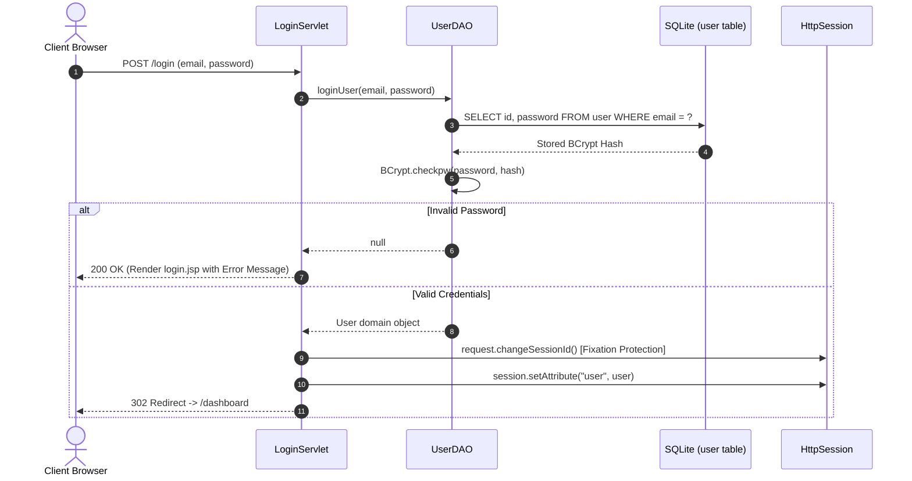
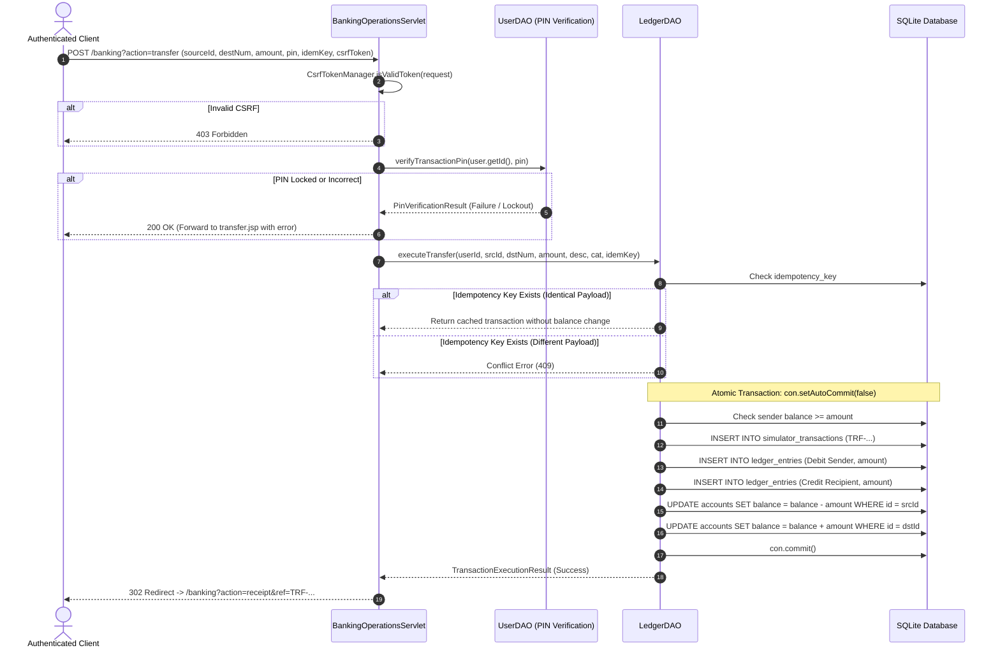
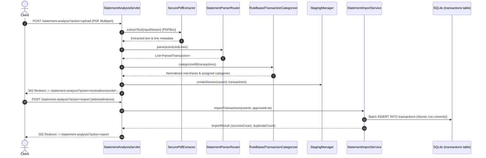

# FinSight — Project Master Document & Architectural Specification

**Product Name:** FinSight — Digital Banking Simulator & Personal Finance Intelligence Platform  
**Target Directory:** `D:\DIVY\webDev\Projects\FinSight`  
**Current Date:** 2026-11-08  
**Architecture Classification:** Monolithic Jakarta EE 10 / Servlet 6.0 Web Application with Embedded SQLite & Apache PDFBox  

---

## 1. PRODUCT OVERVIEW & VISION

### 1.1 Problem Statement
Modern personal finance applications often face a strict trade-off:
- Traditional expense trackers require tedious manual record-keeping, lack realistic transactional mechanics, and do not model institutional banking workflows.
- Real banking environments are heavily restricted, preventing developers, learners, and power users from testing algorithmic financial models, simulating edge cases (such as concurrent double-spend attacks, overdraft limits, or bulk imports), or experiencing double-entry accounting in a safe sandbox.
- Users importing digital bank statements frequently encounter opaque, nondeterministic LLM hallucinations that fabricate transactions or mutate existing account balances without explicit consent.

### 1.2 Product Vision
FinSight bridges this gap by providing an **enterprise-grade digital banking simulator tightly coupled with personal finance intelligence**:
1. **Realistic Banking Operations:** Users create simulated savings and current accounts, deposit simulated funds, withdraw money with PIN validation, and transfer funds between accounts using unique 13-character account numbers (`FS-XXXXXXXXXX`).
2. **Double-Entry Ledger Invariants:** Every monetary movement strictly enforces double-entry accounting ($\sum \text{Debits} = \sum \text{Credits}$) against customer and institutional clearing accounts (`FS-SYSTEM-CLEARING`), ensuring immutable audit trails and real-time balance reconciliation.
3. **Deterministic Statement Analysis:** A local, zero-network, PDFBox-powered parsing engine that extracts, categorizes, stages, and allows manual user approval of bank statement transactions with zero external LLM dependencies.
4. **Personal Financial Intelligence:** Automated spending baseline computation, merchant normalization, category budgeting, spending spike anomaly alerts, and a 100-point holistic financial health scorecard.

---

## 2. TECHNOLOGY STACK & DEPENDENCY INVENTORY

Evidence verified directly from [`pom.xml`](file:///d:/DIVY/webDev/Projects/FinSight/pom.xml) and [`DBConnection.java`](file:///d:/DIVY/webDev/Projects/FinSight/src/main/java/com/expense/util/DBConnection.java):

| Component / Layer | Technology | Version | Purpose & Evidence |
|---|---|---|---|
| **Runtime Language** | Java (JDK) | 17 LTS | Configured via `maven.compiler.release = 17` in `pom.xml`. |
| **Servlet Specification** | Jakarta Servlet API | 6.0.0 | Provided by Apache Tomcat 10.1 container. |
| **JSP & Tag Libraries** | GlassFish JSTL API & Impl | 3.0.0 / 3.0.1 | Jakarta EE 10 compliant standard tag libraries (`jakarta.tags.core`, `jakarta.tags.fmt`). |
| **Servlet Container** | Apache Tomcat | 10.1.34 | Local deployment directory `C:\tools\apache-tomcat-10.1`, listening on port `8080`. |
| **Database Engine** | SQLite JDBC Driver | 3.45.3.0 | Embedded single-file database (`data/finsight.db`) with native driver parameters. |
| **Database Concurrency** | SQLite Native Configuration | WAL Mode | `PRAGMA journal_mode = WAL;`, `PRAGMA busy_timeout = 10000;`, `PRAGMA foreign_keys = ON;`. |
| **Password & PIN Hashing**| jBCrypt | 0.4 | Salted BCrypt hashing (cost 12 for passwords, cost 10 for transaction PINs). |
| **JSON Processing** | Jackson Databind | 2.17.2 | Serializes analytics payloads for client-side Chart.js rendering with XSS escaping. |
| **PDF Extraction** | Apache PDFBox | 3.0.3 | Extracts digital tabular text and line coordinates without external OCR or LLM dependencies. |
| **Unit & Integration Tests**| JUnit 5 (Jupiter) | 5.10.3 | 21 test classes comprising 177 automated test cases. |
| **Client Charting** | Chart.js | 4.x (CDN) | Renders monthly trend line charts and category expense doughnut charts. |

---

## 3. HIGH-LEVEL APPLICATION ARCHITECTURE

The application follows an MVC architecture where Jakarta Servlets act as controllers, JSP templates serve as views, and dedicated Service and DAO layers encapsulate business invariants and SQLite persistence.

```mermaid
flowchart TD
    subgraph Browser ["Client Tier (Browser)"]
        UI["JSP Views + CSS + Chart.js"]
    end

    subgraph ControllerTier ["Controller Tier (Jakarta Servlets)"]
        AuthServlets["LoginServlet / RegisterServlet / LogoutServlet"]
        BankServlets["AccountsServlet / BankingOperationsServlet"]
        TxServlets["ViewTransactionServlet / AddTransactionServlet"]
        IntelServlets["FinancialIntelligenceServlet (/budgets, /alerts, /health)"]
        StmtServlets["StatementAnalysisServlet (/statement-analysis)"]
    end

    subgraph SecurityTier ["Security & Validation Layer"]
        CSRF["CsrfTokenManager (Per-Session Anti-CSRF)"]
        PINAuth["UserDAO PIN Lockout (3 Attempts, 15m Freeze)"]
        SessionRot["request.changeSessionId() Fixation Protection"]
        Ownership["Account & Receipt Ownership Verification"]
    end

    subgraph ServiceTier ["Business & Intelligence Engine"]
        TxService["TransactionService (Date Range & Analytics)"]
        IntelService["FinancialIntelligenceService (Health Score & Baselines)"]
        BudgetEngine["BudgetRecommendationEngine (50/30/20 & Custom Baselines)"]
        AnomalyDet["UnusualTransactionDetector (Spending Spike Alerts)"]
        StmtEngine["StatementAnalysisEngine (PDFBox + Rule Categorizer)"]
        Staging["StagingManager (In-Memory Review Cache)"]
    end

    subgraph DataAccessTier ["Data Access Tier (DAOs)"]
        UserDAO["UserDAO (BCrypt Auth & Lockout)"]
        AccountDAO["AccountDAO (Account Generation & Balances)"]
        LedgerDAO["LedgerDAO (Atomic Double-Entry Posting)"]
        IntelDAO["IntelligenceDAO (Budgets & Anomaly Alerts)"]
        TxDAO["TransactionDAO (Personal & Statement Transactions)"]
    end

    subgraph PersistenceTier ["Database Engine"]
        SQLite[("SQLite 3.45.3 (data/finsight.db)<br/>WAL Mode + Busy Timeout 10s")]
    end

    UI -->|HTTP Requests| ControllerTier
    ControllerTier --> SecurityTier
    SecurityTier --> ServiceTier
    ServiceTier --> DataAccessTier
    DataAccessTier -->|JDBC / PreparedStatements| SQLite
```



---

## 4. REQUEST LIFECYCLE & WORKFLOWS

### 4.1 Authentication & Session Fixation Flow


### 4.2 Banking Operations & Double-Entry Ledger Posting Flow


### 4.3 Statement Analysis & Import Flow


---

## 5. COMPLETE DATABASE SCHEMA SPECIFICATION

The production database resides at `data/finsight.db`. Schema initialization is codified in [`DBConnection.java:100-220`](file:///d:/DIVY/webDev/Projects/FinSight/src/main/java/com/expense/util/DBConnection.java#L100-L220).

### 5.1 Tables & Invariants

#### 1. `user`
- `id INTEGER PRIMARY KEY AUTOINCREMENT`: Unique user identifier.
- `name TEXT NOT NULL`: User full name.
- `email TEXT NOT NULL UNIQUE`: Normalized email address (lowercase).
- `password TEXT NOT NULL`: BCrypt salted hash (cost 12).
- `phone TEXT`: Optional phone number.
- `transaction_pin TEXT`: BCrypt salted hash of 4-to-6 digit PIN (cost 10).
- `pin_attempts INTEGER DEFAULT 0`: Failed PIN attempts counter.
- `pin_locked_until TEXT`: ISO-8601 lockout expiration timestamp.
- `created_at TEXT`: User registration timestamp.
- *Special Record:* `id = 0`, `name = 'FinSight System'` acts as the institutional foreign-key anchor for clearing accounts.

#### 2. `accounts`
- `id INTEGER PRIMARY KEY AUTOINCREMENT`: Internal account identifier.
- `user_id INTEGER NOT NULL`: References `user(id) ON DELETE CASCADE`.
- `account_number TEXT NOT NULL UNIQUE`: 13-character formatted string (`FS-XXXXXXXXXX`).
- `account_type TEXT NOT NULL CHECK(account_type IN ('SAVINGS', 'CURRENT', 'CLEARING'))`.
- `balance REAL NOT NULL DEFAULT 0.00`: Current account balance.
- `status TEXT NOT NULL DEFAULT 'ACTIVE' CHECK(status IN ('ACTIVE', 'INACTIVE', 'LOCKED'))`.
- `created_at TEXT NOT NULL DEFAULT CURRENT_TIMESTAMP`.
- *Institutional Record:* `id = 999999`, `account_number = 'FS-SYSTEM-CLEARING'`, `account_type = 'CLEARING'`.

#### 3. `simulator_transactions`
- `id INTEGER PRIMARY KEY AUTOINCREMENT`: Internal transaction record ID.
- `reference_number TEXT NOT NULL UNIQUE`: Human-readable identifier (`DEP-...`, `WTH-...`, `TRF-...`).
- `transaction_type TEXT NOT NULL CHECK(transaction_type IN ('DEPOSIT', 'WITHDRAWAL', 'TRANSFER'))`.
- `amount REAL NOT NULL`: Transaction monetary amount.
- `description TEXT`: Purpose or note.
- `category TEXT`: Normalized category.
- `status TEXT NOT NULL DEFAULT 'COMPLETED' CHECK(status IN ('PENDING', 'COMPLETED', 'FAILED', 'REVERSED'))`.
- `source_account_id INTEGER`: References `accounts(id)`.
- `destination_account_id INTEGER`: References `accounts(id)`.
- `idempotency_key TEXT UNIQUE`: Client idempotency key preventing duplicate submissions.
- `created_at TEXT NOT NULL DEFAULT CURRENT_TIMESTAMP`.

#### 4. `ledger_entries`
- `id INTEGER PRIMARY KEY AUTOINCREMENT`: Immutable audit log entry ID.
- `transaction_id INTEGER NOT NULL`: References `simulator_transactions(id) ON DELETE RESTRICT`.
- `account_id INTEGER NOT NULL`: References `accounts(id) ON DELETE RESTRICT`.
- `entry_type TEXT NOT NULL CHECK(entry_type IN ('DEBIT', 'CREDIT'))`.
- `amount REAL NOT NULL`: Monetary value of the ledger entry.
- `created_at TEXT NOT NULL DEFAULT CURRENT_TIMESTAMP`.
- *Invariant:* For every `transaction_id`, $\sum \text{amount}_{\text{DEBIT}} = \sum \text{amount}_{\text{CREDIT}}$.

#### 5. `transactions` (Personal & Bank Statement Transactions)
- `id INTEGER PRIMARY KEY AUTOINCREMENT`: Primary key for personal/imported expenses.
- `user_id INTEGER NOT NULL`: References `user(id) ON DELETE CASCADE`.
- `type TEXT NOT NULL CHECK(type IN ('Income', 'Expense'))`.
- `category TEXT`: Category label.
- `amount REAL NOT NULL`: Transaction amount.
- `description TEXT`: Merchant or memo.
- `transaction_date TEXT NOT NULL`: ISO `YYYY-MM-DD` date string.

#### 6. `budgets`
- `id INTEGER PRIMARY KEY AUTOINCREMENT`: Internal budget ID.
- `user_id INTEGER NOT NULL`: References `user(id) ON DELETE CASCADE`.
- `category TEXT NOT NULL`: Expense category.
- `monthly_limit REAL NOT NULL`: Monthly spend threshold.
- `month_year TEXT NOT NULL`: Period identifier (`YYYY-MM`).
- `created_at TEXT NOT NULL DEFAULT CURRENT_TIMESTAMP`.
- *Constraint:* `UNIQUE(user_id, category, month_year)`.

#### 7. `anomaly_alerts`
- `id INTEGER PRIMARY KEY AUTOINCREMENT`: Alert ID.
- `user_id INTEGER NOT NULL`: References `user(id) ON DELETE CASCADE`.
- `transaction_ref TEXT NOT NULL`: Associated reference number.
- `severity TEXT NOT NULL`: Severity rating (`LOW`, `MEDIUM`, `HIGH`).
- `title TEXT NOT NULL`: Summary headline.
- `reason TEXT NOT NULL`: Contextual explanation.
- `risk_score REAL NOT NULL`: Computed anomaly score (0.0 to 100.0).
- `status TEXT NOT NULL DEFAULT 'NEW' CHECK(status IN ('NEW', 'ACKNOWLEDGED'))`.
- `created_at TEXT NOT NULL DEFAULT CURRENT_TIMESTAMP`.

---

## 6. FINANCIAL BUSINESS RULES & INVARIANTS

1. **Strict Double-Entry Balanced Posting:**
   - **Deposits:** Debit `FS-SYSTEM-CLEARING`, Credit customer account.
   - **Withdrawals:** Debit customer account, Credit `FS-SYSTEM-CLEARING`.
   - **Transfers:** Debit sender account, Credit recipient account.
   - Total debits strictly equal total credits for every transaction.
2. **Reconciliation Formula:**
   $$\text{Account Reconciled Balance} = \sum(\text{CREDIT Entries}) - \sum(\text{DEBIT Entries})$$
   Evaluated dynamically via `LedgerDAO.calculateReconciledBalance(accountId)`.
3. **Overdraft Prevention:**
   - Account balances cannot drop below zero.
   - Re-verified within the exclusive database transaction lock immediately prior to updating balances.
4. **Idempotency Fingerprint Validation:**
   - Keys are evaluated against transaction type, amount, source account, and destination account.
   - Conflicting payloads return `409 Conflict` without executing money movement.
5. **Separation of Concerns:**
   - Simulator balances and ledger entries operate exclusively through `accounts`, `simulator_transactions`, and `ledger_entries`.
   - Imported bank statements and manual expense records persist in `transactions`.
   - `ViewTransactionServlet` unifies both domains cleanly in the UI via `UnifiedTransactionItem` without corrupting either underlying ledger.

---

## 7. SECURITY & ACCESS CONTROL SPECIFICATION

1. **Authentication:** Salted BCrypt (cost factor 12) prevents brute-force rainbow table attacks.
2. **Session Fixation Defense:** `request.changeSessionId()` rotates the JSESSIONID upon successful authentication.
3. **Transaction Authorization:** Sensitive operations (withdrawals and transfers) require a transaction PIN verified against salted BCrypt (cost factor 10).
4. **Brute-Force Lockout:** Failed PIN submissions increment an attempt counter. 3 consecutive failures trigger a strict 15-minute freeze (`pin_locked_until`).
5. **CSRF Token Validation:** All state-modifying POST requests require a per-session token validated via `CsrfTokenManager.isValidToken(request)`.
6. **Insecure Direct Object Reference (IDOR) Mitigation:**
   - Account balance queries strictly match `account.getUserId() == user.getId()`.
   - Transaction receipts verify that either `sourceAccountId` or `destinationAccountId` belongs to the requesting user.
7. **SQL Injection Defense:** 100% of SQL statements across all DAOs use parameterized `PreparedStatement` instances.

---

## 8. BUILD, TESTING & DEPLOYMENT INSTRUCTIONS

### 8.1 Build & Test Execution
- **Run All Tests (Isolated Database):**
  ```cmd
  C:\tools\apache-maven-3.9.9\bin\mvn.cmd test -Dsqlite.db.path=target/test-data/test.db
  ```
- **Package Application WAR:**
  ```cmd
  C:\tools\apache-maven-3.9.9\bin\mvn.cmd clean package -DskipTests
  ```

### 8.2 Local Tomcat Deployment
- **Target Tomcat Directory:** `C:\tools\apache-tomcat-10.1\webapps\`
- **Deploy Command:**
  ```powershell
  Copy-Item target\FinSight.war C:\tools\apache-tomcat-10.1\webapps\FinSight.war -Force
  ```
- **Application URL:** `http://localhost:8080/FinSight/`

---

## 9. KNOWN TECHNICAL DEBT & ROADMAP

1. **Integer Paise Storage:** Database schema currently stores currency values as SQLite `REAL`. While safely bridged via Java `BigDecimal` (`HALF_UP`), migrating columns to integer `paise` eliminates potential IEEE 754 precision drift.
2. **Beneficiary Directory:** Add a `beneficiaries` table allowing users to save frequent transfer recipients by nickname instead of typing 13-character account numbers.
3. **Statement Export:** Add CSV/PDF export endpoints to `viewTransaction.jsp`.
4. **Account Controls:** Expose self-serve Freeze/Unfreeze account toggles in `accounts.jsp`.

