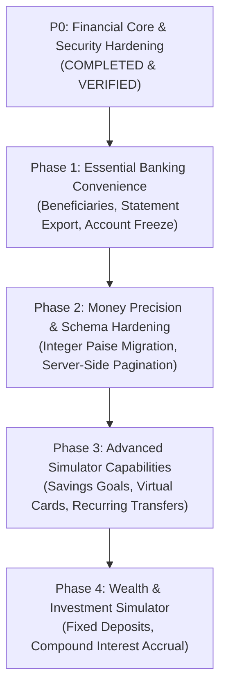

# FinSight — Technical Debt & Implementation Roadmap

**Auditor:** Principal Fintech Product Architect & Senior Software Engineer  
**Scope:** Ranked Technical Debt, Architectural Deficiencies & Prioritized Implementation Phases  
**Date:** 2026-11-08  

---

## 1. RANKED TECHNICAL DEBT INVENTORY

| Rank | Debt Item / Area | Severity | Impact | Remediation Plan |
|---|---|---|---|---|
| **1** | **Monetary Storage in SQLite `REAL`** | Medium | Potential IEEE 754 floating-point rounding drift upon high-volume database-level aggregations. Currently safely bridged in Java by `BigDecimal`. | Execute the 4-phase additive integer `paise` schema migration (`balance_paise`, `amount_paise`). |
| **2** | **Lack of Beneficiary Directory** | Medium | Users must copy-paste or manually type 13-character account numbers (`FS-XXXXXXXXXX`) for every transfer, increasing user error. | Implement `beneficiaries` table (`user_id`, `nickname`, `account_number`) and add selector dropdown in `transfer.jsp`. |
| **3** | **Missing Statement CSV/PDF Export** | Medium | Transaction records can only be viewed in browser tables; users cannot download statements for offline analysis or tax records. | Add `ExportStatementServlet` generating downloadable CSV and PDF files filtered by account and date range. |
| **4** | **No UI Account Freeze/Lock Control** | Low-Medium | Backend supports `status = 'LOCKED'` and enforces it in `LedgerDAO`, but users have no self-serve toggle button in `accounts.jsp`. | Add "Freeze Account" and "Unfreeze Account" action buttons to `accounts.jsp`. |
| **5** | **Client-Side Only Transaction Pagination** | Low | While `ViewTransactionServlet` loads records cleanly, displaying >500 transactions in a single DOM table can cause minor UI lag on mobile devices. | Implement server-side pagination with query parameters `?page=1&limit=50`. |
| **6** | **In-Memory Statement Staging Sessions** | Low | Statement upload staging sessions are cached in JVM memory via `StagingManager`. A server restart while reviewing a statement drops the pending review session. | Migrate staging cache to a temporary SQLite table (`staged_statements`) with expiration timestamps. |

---

## 2. PRIORITIZED IMPLEMENTATION ROADMAP

### Phase 1: Essential Banking Convenience (Immediate Next Steps)
1. **Beneficiary Directory (P1):**
   - Create `beneficiaries` table (`id`, `user_id`, `nickname`, `account_number`, `created_at`).
   - Add "Save Beneficiary" option on transfer success and dropdown selector on `transfer.jsp`.
2. **Account Statement CSV & PDF Export (P1):**
   - Implement `/export` endpoint allowing users to download structured CSV or printable PDF statements for any account and custom date range.
3. **Account Lifecycle Controls (P1):**
   - Add "Freeze / Lock Account" and "Unfreeze Account" action buttons on `accounts.jsp`.

### Phase 2: Financial Precision & Scalability
1. **Integer Paise Additive Migration (P2):**
   - Add `balance_paise INTEGER`, `amount_paise INTEGER` columns to `accounts`, `simulator_transactions`, `ledger_entries`, `transactions`, and `budgets`.
   - Backfill existing data using `CAST(ROUND(amount * 100) AS INTEGER)`.
   - Update Java DAOs for dual-write and mathematical consistency verification.
2. **Server-Side Pagination & Date Filtering (P2):**
   - Add SQL `LIMIT` and `OFFSET` parameters to `ViewTransactionServlet` for high-volume scalability.

### Phase 3: Advanced Fintech Features
1. **Savings Goals & Sub-Accounts (P3):**
   - Create a Goals module where users set target savings amounts (e.g. "Emergency Fund", "Travel") with automated monthly sweep simulation.
2. **Scheduled & Standing Instruction Simulator (P3):**
   - Implement scheduled simulated transfers (e.g. monthly rent payments) executed via background scheduler.
3. **Virtual Debit Card Simulator (P3):**
   - Generate virtual 16-digit cards linked to simulated accounts with customizable online transaction spend limits and freeze toggles.

### Phase 4: Wealth & Investment Simulator
1. **Fixed Deposit & Interest Simulator (P4):**
   - Allow users to lock simulated funds into Fixed Deposits earning monthly compound interest.

